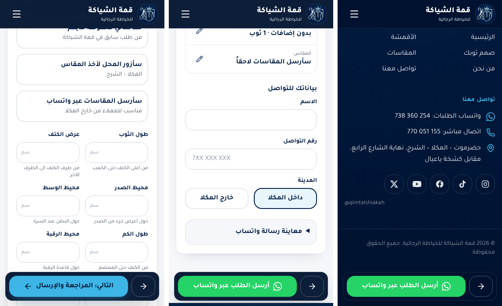
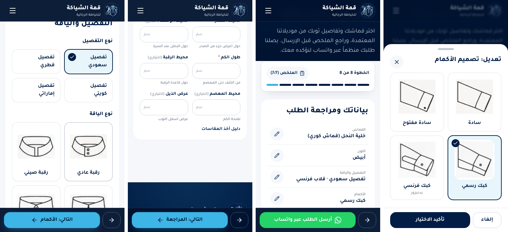

# صفحة «صمم ثوبك» – تقرير الفحص والتطوير

## المشكلات التي وُجدت وأُصلحت
| المشكلة | الإصلاح |
|---|---|
| الزر الثابت أسفل الجوال يغطي حقول المقاسات والنموذج | مساحة سفلية محسوبة مع `env(safe-area-inset-bottom)`، الشريط ملتصق بالحافة مع Safe Area، ويختفي تلقائياً أثناء الكتابة (لوحة المفاتيح)، و`viewport-fit=cover` |
| أيقونة القلم تنقل للخطوة فقط | كل عنصر في الملخص يفتح **Bottom Sheet** (vaul) بالخيارات وصورها، مع «تأكيد الاختيار» و«إلغاء» (الإلغاء لا يغيّر شيئاً) |
| خيارات الياقة/الأكمام/الأزرار عامة ومخترعة | استبدالها بالموديلات المعتمدة من المحل مع صورها: 5 ياقات، 4 أكمام، 6 أزرار (جبزور)، 4 جيوب، 4 أنواع تفصيل (سعودي، قطري، كويتي، إماراتي). حُذفت الإضافات المخترعة واستُبدلت بحقل «تفاصيل إضافية» حر |
| رقم مرجعي يولَّد في المتصفح ويبدو كرقم طلب مسجّل | أُزيل نهائياً (من التصميم وإعادة الطلب)، والنص يوضح أن الفريق يزوّد العميل برقم الطلب عند تسجيله |
| تعبئة الاسم والرقم والمقاسات تلقائياً من الجهاز دون تحقق | لا تعبئة تلقائية؛ المقاسات المحفوظة على الجهاز لا تُعرض ولا تُرفق إلا بعد إدخال رقم جوال مطابق |
| تحقق ضعيف من الرقم والمقاسات | تحقق من رقم يمني (7XXXXXXXX) أو دولي (+/00)، يقبل الأرقام العربية ويحوّلها، مقاسات إلزامية (الطول، الكتف، الصدر، الكم) بين 10–250 سم |
| يمكن إرسال طلب ناقص | الإرسال يُمنع مع قائمة بما ينقص، وكل بند قابل للضغط لفتح نافذة تعديله |
| فقدان الاختيارات عند تحديث الصفحة | مسودة التصميم (بدون بيانات شخصية) تُحفظ في sessionStorage للجلسة فقط |

## إضافات (بعد مراجعة المالك)
- رسالة «توفّر القماش واللون وتفاصيل التفصيل يؤكدها فريقنا معك قبل اعتماد الطلب» في خطوة القماش وفي المراجعة.
- زر «ساعدني في الاختيار عبر واتساب» في خطوة القماش (إضافة لخيار «ساعدوني في اختيار القماش»).
- الألوان تُعرض كـ«اللون المطلوب» مع توضيح أنها ليست قائمة توفّر، وكذلك في رسالة واتساب.
- لا قيود توافق بين الموديلات والأقمشة، ولا أرقام طلبات، والمقاسات المحفوظة تُراجع يدوياً، والأسعار مخفية.

## مسار المقاسات
- **عميل جديد:** إدخال المقاسات الآن / إرسالها عبر واتساب / زيارة المحل.
- **عميل سابق:**
  - «محفوظة لدى المحل»: يُطلب رقم الجوال المسجّل، **لا تُعرض أي مقاسات**، والرسالة تطلب من الموظف استرجاعها ومراجعتها.
  - «محفوظة على هذا الجهاز» (يظهر فقط إن وُجد ملف محلي): تحقق برقم الجوال ثم إرفاق المقاسات.

## الملفات المعدّلة
- `components/design-builder.tsx` – إعادة بناء الصفحة (الخطوات، الملخص، الإرسال، الشريط الثابت).
- `components/design/sections.tsx` – أقسام الاختيار القابلة لإعادة الاستخدام في الخطوات والنوافذ + التحقق.
- `components/design/edit-sheet.tsx` – Bottom Sheet.
- `components/design/measurement-fields.tsx` – حقول المقاسات (نُقلت من design-builder).
- `lib/tailoring.ts` – الخيارات المعتمدة، التحقق من الهاتف والمقاسات، إزالة الرقم المرجعي، إضافة الجيب للرسالة.
- `lib/constants.ts` – حقل اختياري `colors` لكل قماش.
- `components/measurements-manager.tsx` – إزالة الرقم المرجعي واستيراد الحقول الجديدة.
- `components/floating-whatsapp.tsx`, `app/layout.tsx`, `app/globals.css` – Safe Area و`viewport-fit`.
- `app/design/page.tsx` – النص والمسافات.
- `public/design-options/*.webp` – 19 صورة مقتطعة من مرجع الموديلات المعتمد.

## الاختبارات (Playwright) – 43/43 ناجحة
السكربت: `docs/design-page/e2e-design.playwright.js`
فتح الصفحة، منع التقدم دون اختيار، اختيار القماش، اللون، التفصيل والياقة، الأكمام، الأزرار، الجيب والكمية، بقاء الاختيارات عند الرجوع، مسار عميل سابق (المحل) دون عرض مقاسات، مسار المقاسات على الجهاز مع رفض رقم غير مطابق وقبول المطابق وإرفاق المقاسات، رفض مقاسات غير منطقية، منع الطلب الناقص ورسائل التحقق، التعديل عبر النوافذ (اللون، الياقة، الأكمام، الأزرار، الكمية، القماش) والإلغاء، محتوى رسالة واتساب كاملاً وترميز الرابط ورقم 967738360254، عدم وجود رقم طلب وهمي أو أسعار، فتح واتساب عند الطلب الصالح، استعادة المسودة بعد التحديث دون بيانات شخصية، إخفاء الشريط أثناء الكتابة، عدم تغطية الحقول، عدم وجود تمرير أفقي في كل الخطوات على 320/375/390/430/768، وعدم وجود أخطاء JavaScript.

**ملاحظة:** سكربت Vercel Analytics (`/_vercel/insights`) لا يعمل على الخادم المحلي ويعمل فقط على Vercel – ليس خطأً في الكود.

## ما يحتاج Backend أو بيانات من المحل
1. **رقم طلب حقيقي** وتسجيل الطلبات: يحتاج قاعدة بيانات/API.
2. **استرجاع مقاسات العميل السابق آلياً** من سجلات المحل: يحتاج قاعدة بيانات وتحقق (مثل OTP عبر واتساب/SMS). حالياً يراجعها الموظف يدوياً.
3. **الألوان المتوفرة لكل قماش**: الحقل `colors` جاهز في `lib/constants.ts`؛ عند تعبئته تظهر ألوان القماش المختار فقط تلقائياً. حالياً تظهر كل الألوان مع توضيح أن التوفر يُؤكد عند الطلب.
4. **الموديلات المتاحة لكل قماش** (إن كانت بعض الياقات/الأزرار لا تناسب أقمشة معينة): لم تُرسل بيانات بذلك.
5. **الأسعار**: مخفية بطلب المالك (`SHOW_PRICES = false`) رغم ذكرها في المتطلبات العامة.
