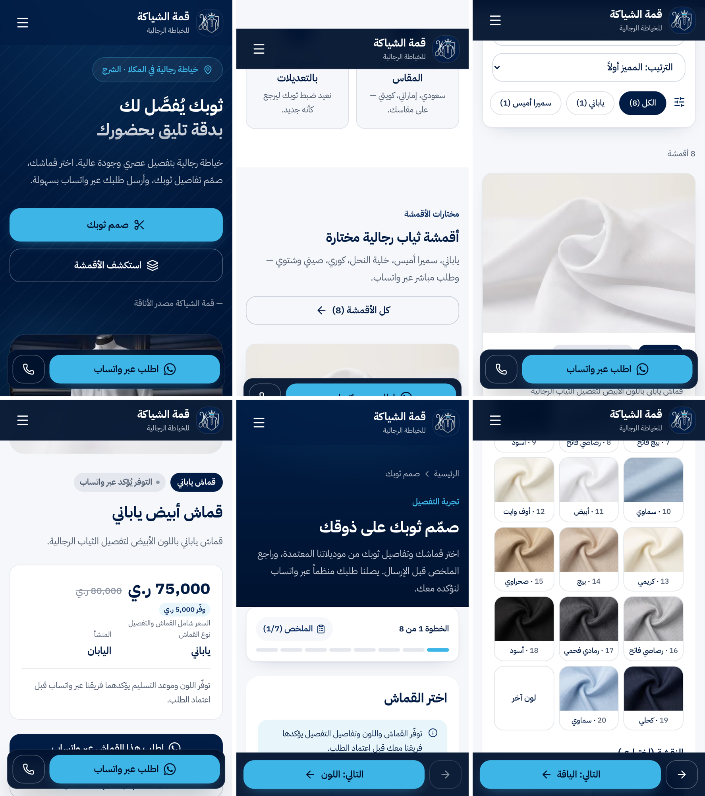

# تقرير تحديث قسم الأقمشة

## الأقمشة المربوطة (8)
| القماش | السعر الأساسي | بعد الخصم | الصور |
|---|---|---|---|
| قماش أبيض ياباني | 80,000 | **75,000** | صورة حقيقية (من المالك) |
| سميرا أميس الصافي | 45,000 | **38,000** | 20 لوناً مرقماً، يبدأ بالأبيض |
| كوري مقلم | 45,000 | **40,000** | بانتظار صورة |
| صيني ممتاز | 45,000 | **35,000** | بانتظار صورة |
| شتوي كاروهات | 50,000 | **45,000** | بانتظار صورة |
| خلية النحل الرسمي | 40,000 | – | 10 ألوان مرقمة |
| خلية مع مقلم | 40,000 | – | 10 ألوان مرقمة |
| خيوط البشت | السعر عند الطلب (لم يُعتمد سعر) | – | صورة حقيقية + 20 لوناً |

جميع الأسعار بالريال اليمني وشاملة القماش والتفصيل. **مكان التعديل الوحيد:** جدول `PRICES` في `lib/constants.ts`.

## الصور
- `public/fabrics/japanese-white.webp`، `semiramis-colors.webp`، `honeycomb-colors.webp`، `honeycomb-striped-colors.webp`، `bisht-threads-real.webp`
- `public/fabrics/semiramis/01..20`، `honeycomb/01..10`، `honeycomb-striped/01..10`، `bisht-threads/01..20` (WebP، مقسمة من كتالوجات المالك، كل لون مستقل؛ خلية النحل وخلية مع مقلم في مجلدين منفصلين)
- لم تُستخدم صور مولدة على أنها صور فعلية. جُرّبت صورة مولدة لـ«خيوط البشت» واستُبعدت لأنها لا تمثل القماش الحقيقي.

## الاختبارات
- المراجعة النهائية **60/60** (الأسعار والخصومات للأقمشة السبعة، السعر المشطوب، «شامل القماش والتفصيل»، الترتيب بالسعر، الألوان المرقمة لكل قماش، النقشات بصورها، التحديد التلقائي للنقشة، 8 قياسات بالإنش، رسالة واتساب بالسعر والإجمالي ورقم الطلب، iPhone، SEO…)
- صفحة التصميم **44/44** · الخطوط **127/127**
- 231 صورة في كل الصفحات وخطوات الألوان: **0 مفقودة**
- كل الصفحات على 320–1440: لا تمرير أفقي ولا أخطاء JavaScript

## ملاحظات المراجعة المستقلة
تم إصلاحه: رأس صفحة «صمم ثوبك» كان يأخذ نصف شاشة الجوال → أصبح مختصراً.

مقترحات متبقية (لم تُنفّذ):
1. صفحة القماش على الجوال تعرض زري واتساب (زر الصفحة + الشريط الثابت). يمكن إخفاء الشريط في صفحات الأقمشة.
2. «خيوط البشت» فيه أسماء ألوان مكررة بين المجموعتين (مثل أبيض 1 وأبيض 11) – الأرقام تميزها، ويُفضّل تسمية المجموعتين.
3. صور «كوري مقلم» و«صيني ممتاز» و«شتوي كاروهات» مطلوبة.
4. صور للنقشات: مقلم، مخطط، كاروهات، وصورة ثوب نص كم.
5. تفعيل Upstash Redis على Vercel لتفعيل أرقام الطلبات QS-0001.
