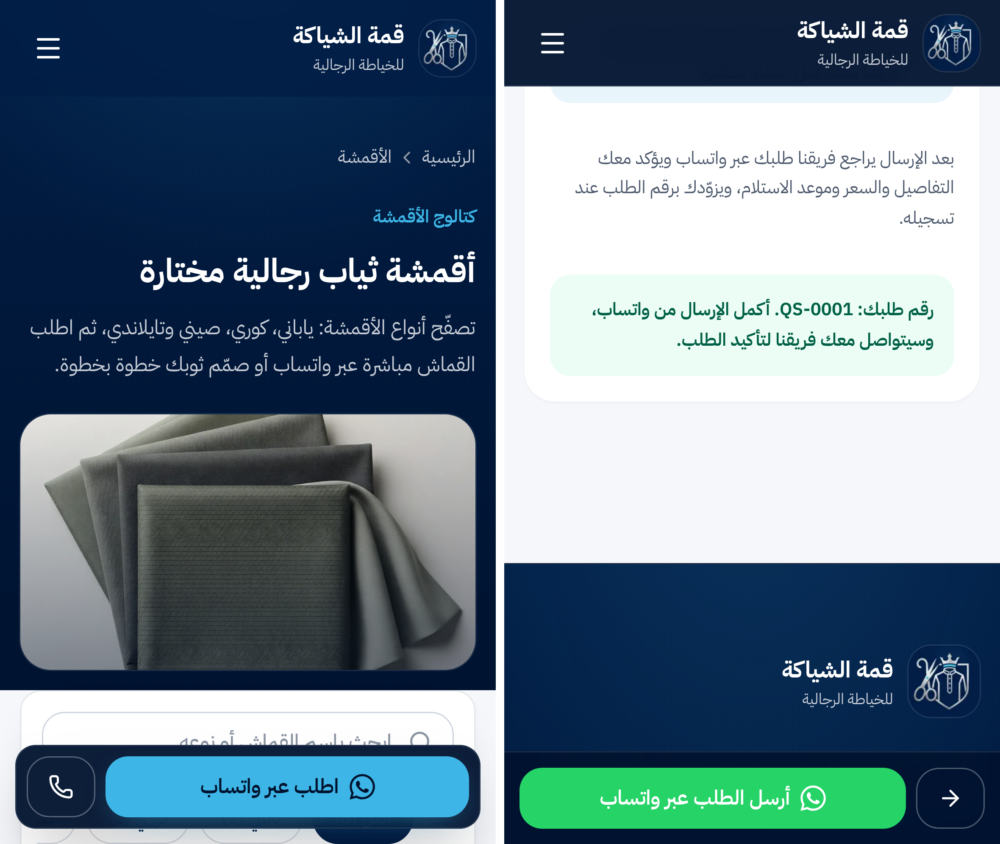
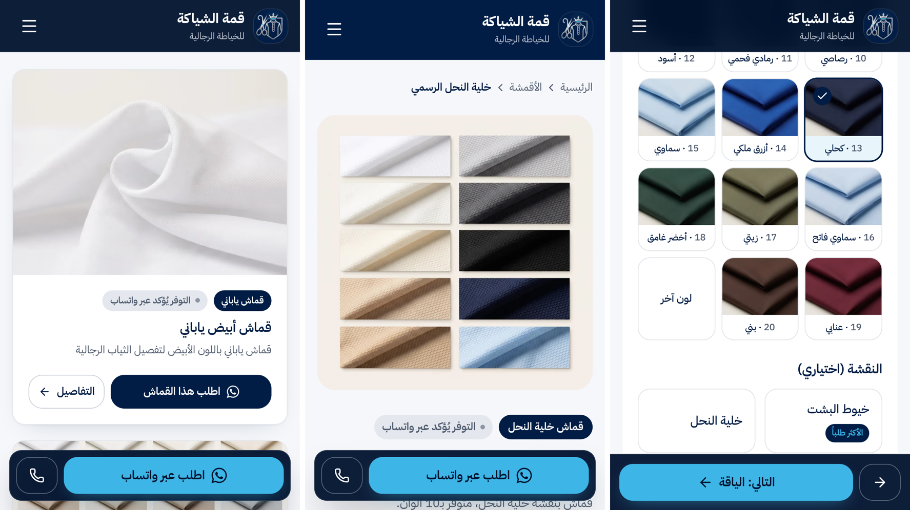

# المراجعة النهائية قبل الاعتماد

## ما تم إصلاحه
| # | البند | الإصلاح |
|---|---|---|
| 1 | ادعاءات استرجاع المقاسات تلقائياً | تصحيح 6 مواضع (الرئيسية، الخطوات، صفحة المقاسات، CTA): المقاسات السابقة **يراجعها الموظف يدوياً حالياً**، مع سطر صريح: «لا توجد حالياً حسابات للعملاء أو استرجاع تلقائي للمقاسات من قاعدة بيانات». |
| 1b | صفحة المقاسات كانت تعرض المقاسات المحفوظة على الجهاز دون تحقق | أصبحت مقفلة حتى إدخال رقم الجوال المطابق (مثل صفحة /design). |
| 2 | رقم الطلب | **نظام ترقيم حقيقي متسلسل QS-0001، QS-0002، …** عبر `/api/orders` ومخزن Redis (Upstash). الرقم يصدر من الخادم فقط، ويُعرض للعميل ويُضاف لرسالة واتساب. لا يُخزَّن أي بيانات شخصية (الرقم والنوع والوقت فقط). حماية: قبول الطلبات من الموقع نفسه فقط + حد 15 طلباً/ساعة لكل عنوان. **إذا لم تُربط قاعدة البيانات** يُرسل الطلب بدون رقم ويُبلَّغ العميل أن الفريق سيزوّده بالرقم – لا يُخترع رقم أبداً. |
| 3 | «صمم ثوبك في دقيقة» | → «صمّم ثوبك بسهولة» (وكذلك «في دقائق» في الواجهة). |
| 4 | بيانات التواصل | موحدة من مصدر واحد (`lib/constants.ts`) وتم التحقق آلياً من كل الصفحات: واتساب 967738360254، اتصال 967770051155، العنوان: الشرج، نهاية الشارع الرابع، مقابل كشخة ياعيال. |
| 9 | SEO | صورة المشاركة (og:image) كانت مفقودة في 5 صفحات داخلية → أُضيفت؛ وصف الصفحة الرئيسية كان 180 حرفاً → 144؛ ترتيب العناوين في صفحة الأقمشة. |
| 9 | السرعة | اهتزاز التخطيط في /design (CLS ‏0.598) → **0** بجعل الصفحة تُبنى مسبقاً؛ أداء /design ‏65 → **89**. |
| – | صور الأقمشة | صورة الأقمشة التي أرسلتها أُضيفت كصورة تعريفية في رأس صفحة الأقمشة (ليست صورة لقماش معيّن). |
| – | فتح واتساب | يُفتح في نافذة جديدة مباشرة عند الضغط (يعمل مع iPhone وحاجب النوافذ)، وإذا أغلق العميل النافذة لا يغادر الصفحة. |

## الاختبارات (Playwright) – كلها ناجحة
| المجموعة | النتيجة |
|---|---|
| المراجعة النهائية `final-review.playwright.js` | **30/30** – الترقيم (QS-0001→0004، عدم تكرار الرقم لنفس الطلب، الطلب التالي يأخذ الرقم التالي)، الوضع بدون قاعدة بيانات، زر الكمبيوتر، صفحة المقاسات (القفل والتحقق وإعادة الطلب برقم)، اكتمال رسالة واتساب (16 حقلاً)، النصوص، التواصل، 5 أجهزة iPhone، SEO، sitemap/robots، الحماية من التكرار، أخطاء JS |
| صفحة التصميم `e2e-design.playwright.js` | **43/43** |
| الخطوط `typography.playwright.js` | **127/127** |
| كل الصفحات على 320/375/390/430/768/1024/1440 | لا تمرير أفقي ولا أخطاء JS |
| أجهزة iPhone | SE ‏(320)، 12 Mini ‏(375)، 13 ‏(390)، 14 Pro Max ‏(430)، 15 Pro Max ‏(430): لا تمرير أفقي، خط IBM Plex محمّل، الأزرار ≥ 40px |

### Lighthouse (جوال، محلياً مع تقييد الشبكة)
| الصفحة | الأداء | الوصول | أفضل الممارسات | SEO | CLS |
|---|---|---|---|---|---|
| / | 83 | 100 | 96 | 100 | 0 |
| /design | 89 | 100 | 96 | 100 | 0 |
| /fabrics | 85 | 100 | 96 | 100 | 0 |
| /measurements | 87 | 100 | 96 | 100 | 0 |
| /contact | 87 | 100 | 96 | 100 | 0 |

أخطاء الـ Console التي يذكرها Lighthouse محلياً سببها بيئة الاختبار فقط (صور الأقمشة الخارجية وGoogle Ads محجوبة، وسكربت Vercel Analytics لا يعمل إلا على Vercel).

## ما لم يتم اختباره
1. **متصفح Safari الحقيقي (WebKit) وأجهزة iPhone الفعلية**: الاختبار تم بمحاكاة أجهزة iPhone على Chromium.
2. **Upstash Redis الفعلي**: الترقيم اختُبر مع خادم محلي يطابق واجهة Upstash؛ يحتاج ربط قاعدة البيانات على Vercel (انظر أدناه) ثم تجربة طلب واحد.
3. **وصول رسالة واتساب فعلياً** إلى الرقم: اختُبر الرابط والنص المرمّز، وليس الإرسال من تطبيق واتساب.
4. **Lighthouse على Vercel** (الأرقام أعلاه محلية بتقييد شبكة).
5. **روابط فيسبوك/يوتيوب/إكس** مبنية من اسم المستخدم الموحد ولم يتم التحقق من وجود الحسابات.

## خطوة مطلوبة لتفعيل أرقام الطلبات
Vercel → المشروع → **Storage** → **Create** → **Upstash for Redis** (الخطة المجانية) → ربطه بالمشروع لكل البيئات. يضيف تلقائياً `KV_REST_API_URL` و`KV_REST_API_TOKEN`. بعدها إعادة نشر المعاينة. حتى ذلك الحين تُرسل الطلبات بدون رقم (دون اختراع رقم).

---

## تحديث: البيانات المعتمدة من المحل
- **القياسات (بالإنش):** الطول، الكتف، طول اليد، العرض، الرقبة، فتح اليد (الإبط)، وسط اليد، أسفل اليد (الكبك). الإلزامية: أول خمسة.
- **الألوان:** أبيض، سكري، بيج، صحراوي، رصاصي، كحلي، أسود (+ لون آخر).
- **النقشات:** خيوط البشت (الأكثر طلباً)، خلية النحل، خلية مع مقلم، مقلم، مخطط، كاروهات، سادة.
- **الأكمام:** أُضيف «نص كم».
- **الكتالوج (حُذفت الصور القديمة بالكامل):**
  | القماش | السعر (الثوب كامل: قماش + تفصيل) | الصور |
  |---|---|---|
  | قماش أبيض ياباني | 80,000 ر.ي | ✔ |
  | سميرا أميس الصافي – رقم 1 | 40,000 ر.ي | ✔ 20 لوناً مرقماً |
  | خلية النحل الرسمي | 40,000 ر.ي | ✔ 10 ألوان مرقمة |
  | كوري مقلم | بانتظار البيانات | الصورة قريباً |
  | صيني ممتاز | بانتظار البيانات | الصورة قريباً |
  | شتوي كاروهات | بانتظار البيانات | الصورة قريباً |
- الأسعار محفوظة ومخفية (`SHOW_PRICES = false`).
- الاختبارات: المراجعة النهائية **53/53**، صفحة التصميم **43/43**، الخطوط **127/127**.

