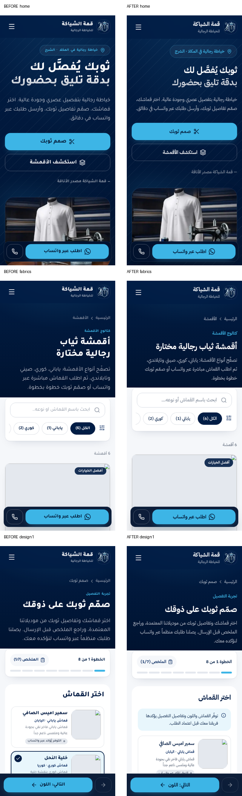
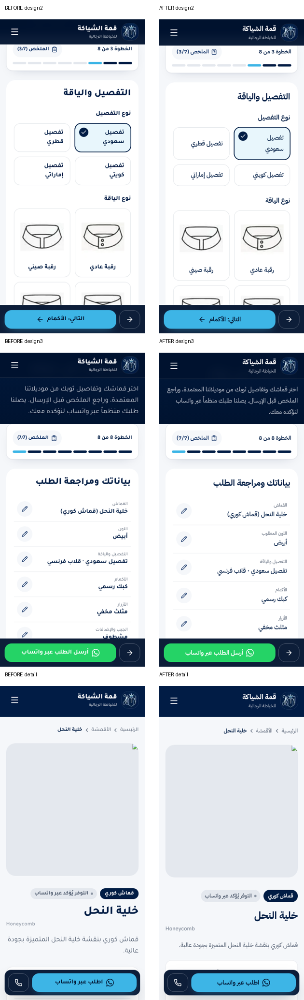
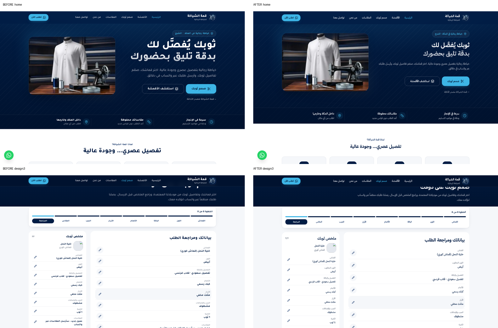

# نظام الخطوط – IBM Plex Sans Arabic

## قبل / بعد
| | قبل | بعد |
|---|---|---|
| الخط | Tajawal + ملف Geist قديم غير مستخدم (`styles/globals.css`) | **IBM Plex Sans Arabic** فقط (حُذف الملف القديم) |
| الأوزان المحمّلة | 400، 500، 700، **800** | **400، 500، 600، 700** |
| استخدام الأوزان | 55 عنصر بوزن 800 و57 بوزن Bold، حتى في النصوص العادية | العناوين 700، العناوين الفرعية 600، الأزرار والنصوص التفاعلية 600/500، الاختيارات 500، الوصف 400 |
| الأحجام | 13 حجماً عشوائياً (حتى 60px للـ Hero) | سلّم ثابت: Hero ‏28/36، H1 ‏26/32، H2 ‏22/26، H3 ‏19/22، Body ‏16، Caption ‏14، Small ‏12 |
| تباعد الحروف | `tracking` على نصوص عربية (يفكك الحروف العربية) | أُزيل من كل النصوص العربية |
| ارتفاع السطور | `leading-tight` (1.25) على العناوين العربية | 1.4–1.55 للعناوين، 1.8 للنص، 1.7 للـ Caption |
| الأرقام | عادية | `tabular-nums` للكميات والأسعار والمقاسات، وأرقام الهاتف `dir=ltr` |
| التحميل | — | `next/font` (استضافة ذاتية) + `font-display: swap` + `preload` + خط احتياطي مضبوط القياس لمنع اهتزاز التخطيط |

## الأصناف (Classes)
`type-hero`، `type-h1`، `type-h2`، `type-h3`، `type-title` (عناوين البطاقات 17px/600)، `type-body`، `type-caption`، `type-small`، `num` – في `app/globals.css`.

## الاختبارات
- `docs/typography/typography.playwright.js`: **127/127** – كل الصفحات الثمانية (بما فيها 404) على 375px و1440px: خط واحد، أوزان ضمن 400–700، أحجام Hero/H1/H2/H3 مطابقة، Body 16px، لا تباعد حروف عربي، لا تمرير أفقي، `font-display: swap`، ولا خطوط أخرى.
- `docs/design-page/e2e-design.playwright.js`: **43/43**.
- فحص كل الصفحات على 320/375/390/430/768/1024/1440: لا تمرير أفقي ولا أخطاء JavaScript.

## ملاحظات
- `type-title` (17px) إضافة على السلّم المطلوب لعناوين البطاقات الصغيرة (الخدمات، الخطوات)، لأن H3 ‏19–22px يزاحم البطاقات الضيقة على الجوال.
- Hero بحجم 36px على الكمبيوتر أصغر بصرياً من السابق (60px) – مطابق للمطلوب، ويمكن رفعه لاحقاً إن رغبتم.
- يتم تحميل 16 ملف woff2 (240KB إجمالاً) لكن المتصفح ينزّل فقط ما يحتاجه حسب الحروف (العربية + اللاتينية).
